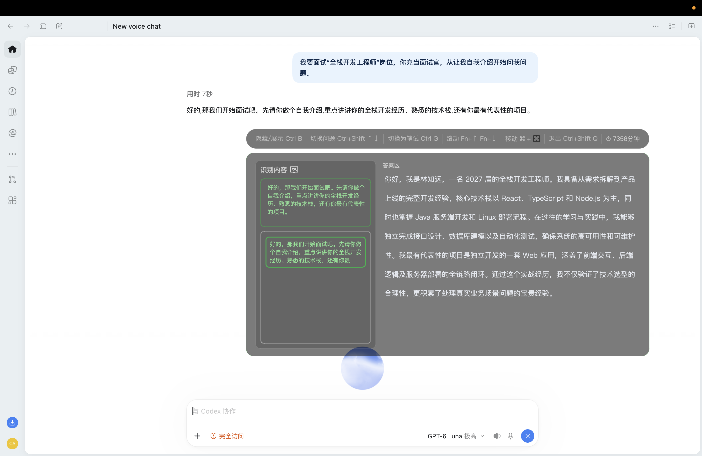

# IVMate · AI Interview Assistant

**Be better prepared for every interview.**

Live interview answers · Screenshot-based coding help · Personal context · Session review

For **macOS (Apple Silicon / Intel)** and **Windows**.

**[Website](https://rocketman.top/) · [Download](https://rocketman.top/download/) · [User guide](https://rocketman.top/guide/)**

[简体中文](README.md)

---

IVMate brings interview preparation, spoken Q&A, coding assistance, and session review into one desktop app. It recognizes audio playing on your computer and streams suggested answers in an overlay. Switch to written-exam mode to submit screenshots and read the solution approach and code.

This repository contains public product documentation and presentation assets. Get the desktop app from the official website.

## See it in action

*An example from the official tutorial. Some tutorial screenshots show earlier versions; current interface details may differ.*

See the Chinese README for [more screenshots](README.md#实际效果), or visit the [coding-mode tutorial](https://rocketman.top/guide/exam/) for solution and screen-sharing examples.

## Features

| Feature | What it does |
| :--- | :--- |
| Live interview assistance | Recognizes system audio and streams suggested answers. |
| Conversation context | Uses earlier Q&A in the current interview to help interpret follow-up questions. |
| Personal profile | Organizes a resume, supporting documents, and answer preferences before the interview. |
| Editable long-term memory | Keeps personal experience locally, with search, editing, deletion, and individual document views. Interview records can be archived selectively. |
| English interviews | A separate interview option enables English answers independently of the interface language. |
| Coding and written-exam mode | Submit up to **6 screenshots per question**, then read the approach and code with matching line numbers. |
| Overlay controls | Keyboard shortcuts for visibility, mode switching, capture, scrolling, and question history. |
| Screen-capture protection | Provides system-level overlay protection. Behavior depends on the OS and capture method; verify your setup beforehand. |
| Local review | Browse local session records and export to HTML or Markdown. |

Personal memory and conversation context apply to interview mode. Written-exam mode analyzes the submitted question images separately.

## Get started

1. [Download IVMate](https://rocketman.top/download/). Choose the separate Apple Silicon or Intel package on Mac, or the Windows 10 / 11 64-bit installer.
2. Sign in with your phone number and verification code. Complete the permissions requested by the app and check your available time.
3. Optionally add your resume and experience documents to **Personal Profile**. Supported formats: PDF, DOCX, TXT, and MD.
4. Start the assistant. Use `Ctrl + G` to switch to written-exam mode, `Ctrl + H` to capture, and `Ctrl + J` to submit or move to the next question as indicated in the overlay.
5. Exit with `Ctrl + Shift + Q`, then review the session in the desktop client.

On macOS, `Ctrl` means **Control**. Move the overlay with `⌘ + Arrow` on Mac or `Ctrl + Arrow` on Windows. Scroll with `Fn + ↑ / ↓` on Mac or `Page Up / Page Down` on Windows. See the [shortcut guide](https://rocketman.top/guide/shortcuts/) for details.

## Data and privacy

Long-term memory and session records are stored on the current computer. They do not automatically sync when you sign in on another device. Original documents are parsed locally; extracted text is sent to AI services for online processing. Speech recognition, AI answers, and submitted screenshot analysis also use online services.

This public repository contains no application source code, credentials, user archives, or installation packages. Please remove personal information before posting an issue.

[Privacy policy](https://rocketman.top/privacy) · [Terms](https://rocketman.top/terms) · [FAQ](docs/FAQ.md) · [Asset notes](assets/README.md) · [Rights notice](NOTICE.md)

---

**[Visit IVMate](https://rocketman.top/) · [Download the desktop app](https://rocketman.top/download/)**
