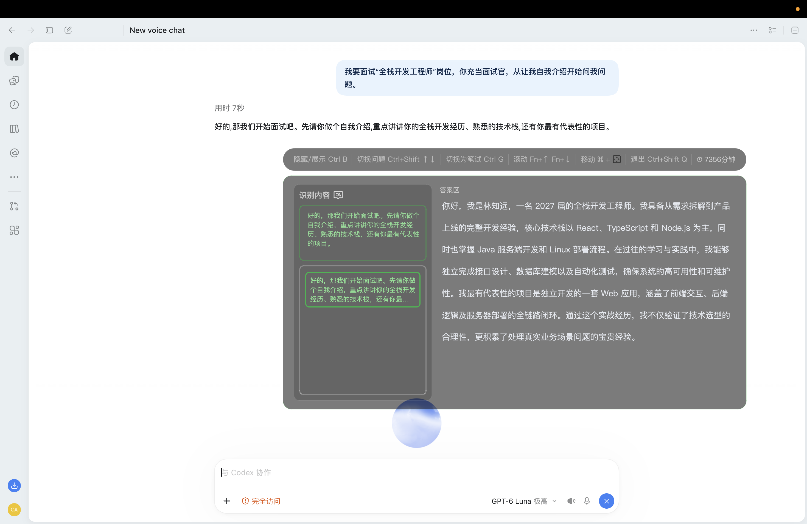
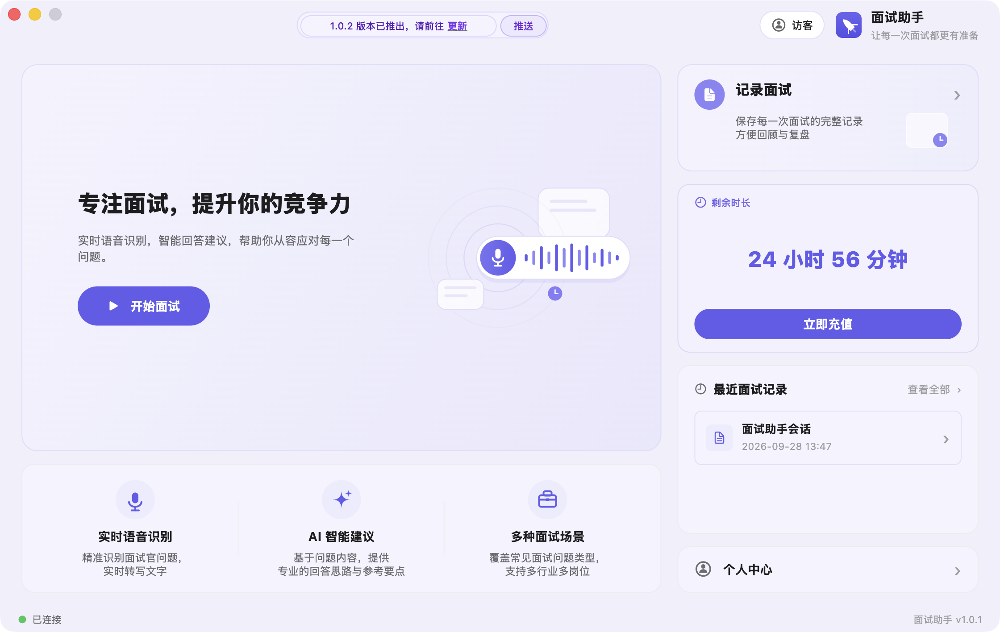
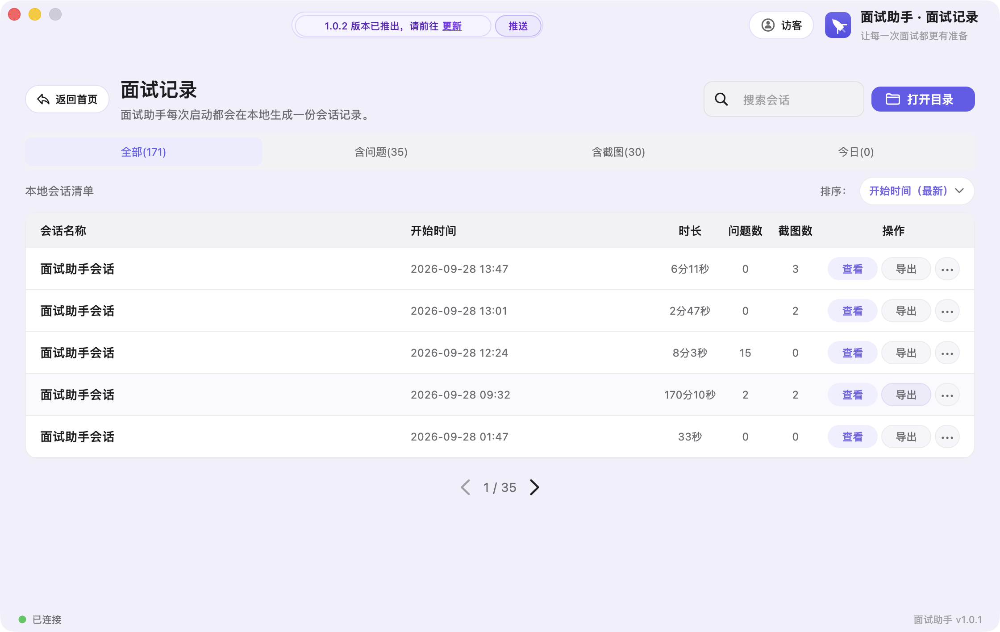

# IVMate · AI 面试助手

**让每一次面试都更有准备。**

实时语音问答 · 截图解题 · 简历与长期记忆 · 面试复盘

适用于 **macOS（Apple Silicon / Intel）** 与 **Windows** 的桌面 AI 面试助手。

**[访问官网](https://rocketman.top/) · [下载客户端](https://rocketman.top/download/) · [阅读使用教程](https://rocketman.top/guide/)**

[English](README.en.md)

---

IVMate 将面试问答、笔试解题和个人经历整理放进同一个桌面助手：识别电脑播放的语音，围绕问题提供回答建议；遇到编程题时，切换笔试模式，通过截图获取解题思路与代码。

在面试前整理简历与项目细节，在面试中结合个人档案和本场对话上下文组织回答，在结束后回看本地记录，让准备、练习和复盘衔接起来。

> 这是 IVMate 的产品介绍与使用指引仓库，仅包含公开文档和展示图片。客户端安装包请从官网获取。

**快速导航：** [实际效果](#实际效果) · [功能一览](#功能一览) · [开始使用](#开始使用) · [快捷键](#快捷键) · [数据与隐私](#数据与隐私) · [常见问题](docs/FAQ.md)

## 实际效果

### 识别提问，呈现回答

面试模式持续识别面试官的问题并实时快速返回答案，在悬浮窗内呈现识别内容与回答建议，低延迟可直接口述回答。

### 一个客户端，连接准备与使用

从首页启动面试助手，查看可用时长与最近记录。新版个人档案入口可用于维护简历、长期记忆和回答偏好。

<strong>展开查看客户端首页截图</strong>

*此图为官网教程中的早期版本截图，其中“记录面试”入口现已更新为“个人档案”；版本文字、入口和实际布局以当前客户端为准。*

### 本地记录，方便复盘

按会话回看面试问题、回答和笔试截图，搜索记录，并导出为 HTML 或 Markdown。

<strong>展开查看面试记录截图</strong>

*来自官网教程的访客界面，展示记录列表与操作方式。*

笔试模式的解题与代码展示，以及本机与共享画面对比，请查看 **[笔试模式图文教程](https://rocketman.top/guide/exam/)**。

## 功能一览

| 功能 | 使用方式与作用 |
| :--- | :--- |
| **实时面试问答** | 识别电脑播放的语音，流式呈现回答建议，保持面试中的阅读节奏。 |
| **本场对话记忆** | 面试模式结合本次会话中已有的问答上下文，帮助理解追问与延续话题。 |
| **个人档案与简历整理** | 在“个人档案”中上传简历，整理个人背景；更换简历时再更新，无需每次启动重复提炼。 |
| **可编辑的长期记忆** | 上传教育、实习、项目与个人经历等细节文件，也可按需归档面试记录；支持查找、编辑、删除与独立档案查看。 |
| **回答偏好** | 在个人档案中维护回答偏好，让面试模式的表达更贴合使用需求。 |
| **纯英文面试** | 启动前按需开启独立的纯英文面试选项，适配英文问答；与客户端界面语言分别设置。 |
| **笔试截图解题** | 同一题最多提交 **6 张截图**，整理题目理解、核心要点、解题思路与代码；代码行号随实际内容呈现。 |
| **悬浮窗与快捷键** | 通过快捷键切换模式、截图、显隐窗口、翻看问题与滚动答案。 |
| **屏幕共享保护** | 提供助手窗口的系统级捕获保护；实际效果与操作系统及共享方式有关，可先参考教程进行验证。 |
| **记录与导出** | 本地保存会话记录，支持搜索、筛选和导出，用于练习与复盘。 |

个人档案和本场对话记忆用于**面试模式**；笔试模式按截图题目分析，不混入面试模式的长期记忆与对话上下文。

## 开始使用

### 1. 下载对应安装包

| 你的电脑 | 下载选择 |
| :--- | :--- |
| Mac · Apple Silicon（M 系列） | [官网下载页 → Apple 芯片版](https://rocketman.top/download/) |
| Mac · Intel | [官网下载页 → Intel 版](https://rocketman.top/download/) |
| Windows 10 / 11 · 64 位 | [官网下载页 → Windows 版](https://rocketman.top/download/) |

Mac 的两个芯片版本分别提供安装包。可在苹果菜单“关于本机”查看芯片类型；具体系统要求与最新版本以官网下载页为准。

### 2. 登录并完成准备

打开客户端，使用手机号验证码登录，检查剩余时长。按客户端提示完成必要的系统授权，确认电脑能够正常播放会议声音。

### 3. 按需完善个人档案

进入“个人档案”，上传简历与细节文件，维护长期记忆和回答偏好。简历与细节文件支持 PDF、DOCX、TXT、MD。不使用个人档案也可以启动助手。

### 4. 启动助手，选择场景

- **语音面试：** 点击“开始面试”，按需输入公司、目标岗位，选择是否开启纯英文面试，然后启动助手。
- **笔试解题：** 在助手中按 `Ctrl + G` 切换模式，按 `Ctrl + H` 截图，最多添加 6 张同一题的图片，再按 `Ctrl + J` 提交。
- **结束复盘：** 按 `Ctrl + Shift + Q` 退出助手，在客户端回看本地面试记录。

完整步骤与授权说明：[下载安装](https://rocketman.top/guide/install/) · [面试模式](https://rocketman.top/guide/interview/) · [笔试模式](https://rocketman.top/guide/exam/) · [记录与导出](https://rocketman.top/guide/records/)

## 快捷键

| 操作 | macOS | Windows |
| :--- | :--- | :--- |
| 隐藏 / 显示助手 | `Ctrl + B` | `Ctrl + B` |
| 切换面试 / 笔试 | `Ctrl + G` | `Ctrl + G` |
| 笔试截图 | `Ctrl + H` | `Ctrl + H` |
| 笔试发送 / 下一题 | `Ctrl + J` | `Ctrl + J` |
| 面试中切换历史问题 | `Ctrl + Shift + ↑ / ↓` | `Ctrl + Shift + ↑ / ↓` |
| 滚动答案 | `Fn + ↑ / ↓` | `Page Up / Page Down` |
| 移动窗口 | `⌘ + 方向键` | `Ctrl + 方向键` |
| 退出助手 | `Ctrl + Shift + Q` | `Ctrl + Shift + Q` |

Mac 上的 `Ctrl` 指 **Control**；移动窗口使用 **Command（⌘）**。以客户端顶部快捷键提示及[完整快捷键教程](https://rocketman.top/guide/shortcuts/)为准。

## 数据与隐私

- 长期记忆与面试记录存储在当前电脑；同一账号登录另一台电脑，不会自动带走本机档案与历史记录。
- 上传文档时，原始文件在本机解析；在线整理会将提取出的文本交由 AI 服务处理。原始文件保留在本机。
- 实时语音识别、AI 回答和用户主动提交的截图分析需要网络及相应在线服务。本地存储不代表全部计算离线进行。
- 本仓库不收集用户档案，不包含客户端、服务端或网关源码，也不提供账号数据、密钥、数据库、日志或签名材料。

具体数据处理说明请阅读官网[隐私政策](https://rocketman.top/privacy)与[用户协议](https://rocketman.top/terms)。

## 问题与建议

先查看[常见问题](docs/FAQ.md)或[官网排查教程](https://rocketman.top/guide/troubleshooting/)。也可以在本仓库的 Issues 中提交使用问题或功能建议；请先删除截图和描述中的手机号、验证码、简历、面试记录等个人信息。

本仓库中的截图取自官网公开教程，部分为早期版本，不能用来判断当前版本号、账户权益或全部界面细节。素材说明见 [assets/README.md](assets/README.md)。

---

**准备好下一次面试了吗？**

**[前往 IVMate 官网](https://rocketman.top/) · [下载 macOS / Windows 客户端](https://rocketman.top/download/)**

IVMate 产品名称、标志与展示素材的权利说明见 [NOTICE.md](NOTICE.md)。

